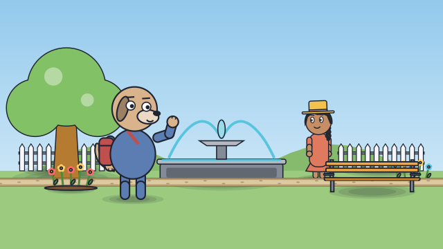
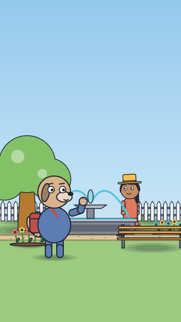

# Passing in the park

<!-- Generated by `vidgen gallery`; edit src/vidgen/data/gallery/showcases/walk_in_depth.yaml, not this file. -->

**Use it for:** characters walking towards and away from the camera, passing in front of each other.

A showcase of [`stage`](stage.md): a small scene written for the gallery, a whole `video.yaml`. Copy it into a
project and run `vidgen render`; until `vidgen tts` voices it, its beats are timed by their word count.

The scene playing, 16:9 and 9:16:

<picture><source media="(prefers-reduced-motion: reduce)" srcset="media/walk_in_depth-16x9.png"></picture> <picture><source media="(prefers-reduced-motion: reduce)" srcset="media/walk_in_depth-9x16.png"></picture>

Last beat:

 

## YAML

```yaml
title: Passing in the Park
characters:
  - name: posy
    look: {body: tall, eyes: oval, hair: braids, outfit: dress, accessories: [hat]}
    colors: {skin: "#C68E64", clothes: "#E07A5F", hair: "#2B2B2B", accessory: "#F2C14E"}
  - name: dunn
    look: {species: dog, body: round, eyes: round, accessories: [backpack]}
    colors: {skin: "#D9B38C", clothes: "#5B7DB1", accessory: "#C0504D"}
scenes:
  - id: walk_in_depth
    type: stage
    set: park
    params:
      characters:
        - {name: posy, at: 0.25}
        - {name: dunn, at: 0.75, depth: 0.7, facing: left}
    beats:
      - text: "Posy strolled deeper into the park, as Dunn came the other way."
        actions:
          - {walk_to: posy, to: {mark: 0.72, depth: 0.7}, at: 0.05}
          - {walk_to: dunn, to: {mark: 0.3, depth: 0}, at: 0.1}
      - text: "Far away now, Posy turned and waved."
        actions:
          - {turn: posy, to: left, at: 0.05}
          - {gesture: posy, to: wave, at: 0.25}
          - {look_at: dunn, to: posy, at: 0.2}
          - {gesture: dunn, to: wave, at: 0.45}
```

[All scene types and showcases](README.md) · `vidgen guide cartoons` · `vidgen guide iso` · `vidgen guide platform`
