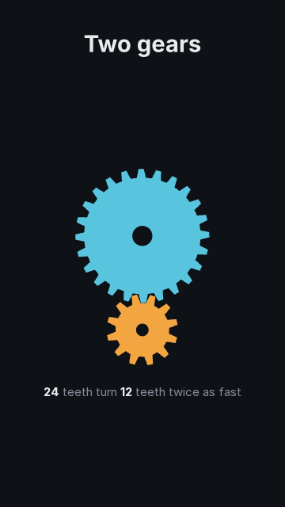
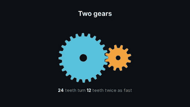
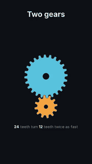

# `web`

<!-- Generated by `vidgen gallery`; edit the sample in AGENTS.md (or video.yaml), not this file. -->

**Use it for:** a picture or animation no built-in draws, written yourself in HTML, CSS and JavaScript: a bespoke layout, CSS or SVG animation, a canvas drawing, your own three.js scene (`vidgen guide web`).

A page written in HTML, CSS and JavaScript, shown full-bleed (`region: bleed`) or in the body region under a title (`region: body`; the page is laid out at that region's size): `page:` names an HTML file of the project (any HTML, CSS and JavaScript; relative links work) or `script:` a JavaScript module that vidgen loads into a bare page with one canvas filling the frame. Time belongs to vidgen: the page's timers, `requestAnimationFrame`, `Date`, CSS, SVG and video animations follow the video's time and `Math.random` is seeded from the scene id, so ordinary web code renders the same every time. Optional hooks: `load(ctx)` once before frame 0 and `frame(t, ctx)` before each screenshot (`t`: seconds from the scene's start; a page sets `window.vidgen = {load, frame}`, a script exports them). The page is given the theme (`ctx.theme` and CSS variables such as `var(--vidgen-primary)`, with the bundled fonts), `data:` (`ctx.data`) and the narration beats (`ctx.beats`; `<body data-beat="b2">` and a `vidgen-beat` event); `import * as THREE from "three"` loads the bundled three.js; `ctx.aspect` (`16:9`, `9:16`...) and `<html data-aspect="9:16" data-orientation="portrait">` let one page lay itself out for each shape of the video. What the page leaves transparent (a page without a background, the bare page of a script) shows the video's background. Nothing is fetched from the internet. The page is on screen from the first frame, beat 1 fades the title in, the scene fades out at the end. Drawn in headless Chromium (once: `python -m playwright install chromium`).

Last beat, 16:9 and 9:16:

 

The scene playing (GIF, up to its last beat):

 

## YAML

From the author guide (`vidgen guide scenes`):

```yaml
- id: gears
  type: web
  params: {page: extensions/gears.html, region: body, title: "Two gears"}   # or script: extensions/gears.js (one canvas)
  beats: [{text: "Two gears turn together."}]
```

## Params

| param | type | default | notes |
|---|---|---|---|
| `page` | `str \| None` |  | An HTML file in the project folder (`extensions/gears.html`): any HTML, CSS and JavaScript; relative links to styles, pictures, fonts and modules are served from the project folder. |
| `script` | `str \| None` |  | A JavaScript module in the project folder (`extensions/gears.js`), loaded into a bare page with one canvas (`id="vidgen-canvas"`, the page's size; also `ctx.canvas`) on a transparent background (what it does not draw shows the video's background). |
| `title` | `str` |  | Heading drawn by vidgen: on a plate over the top of the page with region: bleed, above it with region: body. (also: heading) |
| `region` | `'bleed' \| 'body'` | `'bleed'` | Where the page goes: bleed (the whole frame, edge to edge) or body (the safe area below the title; the page is laid out at that size). |
| `data` | `dict[str, Any]` |  | Values for the page, as the page reads them in `ctx.data` (`{teeth: 24, color: primary}`): text, numbers, true/false, null, lists and mappings; theme colour names are not resolved (the page looks them up in `ctx.theme.colors`). |

## Targets

`view`, `title`

## Beats

Any number.

[All scene types](README.md) · `vidgen list-scenes` · `vidgen schema --scene web`
