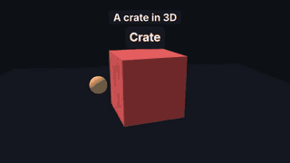
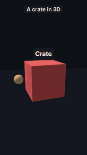
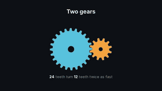
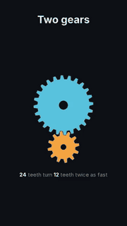
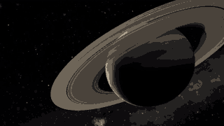
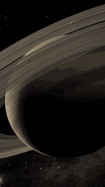

# Web scene gallery

<!-- Generated by `vidgen gallery`; do not edit. -->

The scene types drawn by a web page in headless Chromium (HTML, CSS, JavaScript, three.js), rendered
from their samples in the author guide (`AGENTS.md`, `vidgen guide scenes`) like every other type in
the [scene gallery](../README.md). The previews are animated: each GIF plays the scene at 16:9 and
9:16 and holds its last beat (viewers who ask for reduced motion see that still instead).
Each page has the YAML, the params, the action targets and the stills.
Regenerate with `vidgen gallery`.

## Pictures and media

Whole films of `web` scenes: [Escapement](../../../examples/escapement/README.md) (`examples/escapement`), a 3:11 clockwork music film in three.js whose watch movement ticks on the score's beat, [Parallel Space](../../../examples/parallel-space/README.md) (`examples/parallel-space`), a 3:05 trance and choir film of a flight through parallel realities, and [Signal Fire](../../../examples/signal-fire/README.md) (`examples/signal-fire`), a 27 s orchestral cue with its picture. A film of `space` scenes written in YAML alone: [Outbound](../../../examples/outbound/README.md) (`examples/outbound`), 58 s from a sunrise over a world, past a ringed giant, to a black hole, with an orchestral score. How to make them: [the 3D cookbook](../../COOKBOOK-3D.md) and [the space cookbook](../../COOKBOOK-SPACE.md).

| type | preview | use it for |
|---|---|---|
| [`3d`](3d.md) | <a href="3d.md"><picture><source media="(prefers-reduced-motion: reduce)" srcset="media/3d-16x9.png"></picture></a> <a href="3d.md"><picture><source media="(prefers-reduced-motion: reduce)" srcset="media/3d-9x16.png"></picture></a> | simple 3D: shapes, labels and character stand-ins seen by a camera that stands still or moves on words (orbit, push in, fly to an object), objects that move, turn, appear, glow and walk on words, groups that move together |
| [`web`](web.md) | <a href="web.md"><picture><source media="(prefers-reduced-motion: reduce)" srcset="media/web-16x9.png"></picture></a> <a href="web.md"><picture><source media="(prefers-reduced-motion: reduce)" srcset="media/web-9x16.png"></picture></a> | a picture or animation no built-in draws, written yourself in HTML, CSS and JavaScript: a bespoke layout, CSS or SVG animation, a canvas drawing, your own three.js scene (`vidgen guide web`) |
| [`space`](space.md) | <a href="space.md"><picture><source media="(prefers-reduced-motion: reduce)" srcset="media/space-16x9.png"></picture></a> <a href="space.md"><picture><source media="(prefers-reduced-motion: reduce)" srcset="media/space-9x16.png"></picture></a> | space with no code: a sky, a sun, planets with rings and air, craft on a real transfer, a black hole, a jump to warp, camera moves on bar lines; true positions and timing from orbit data (`vidgen guide space-scenes`) |
