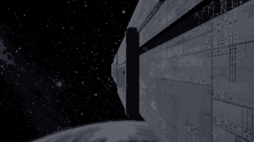
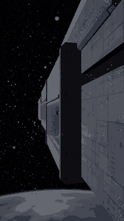
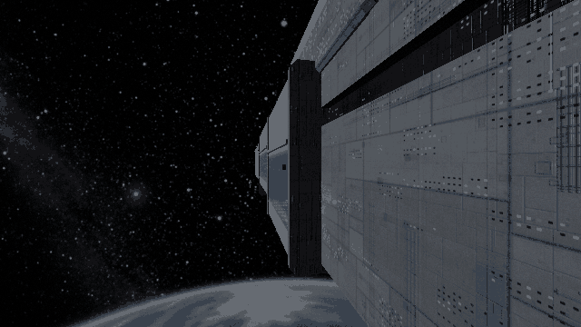
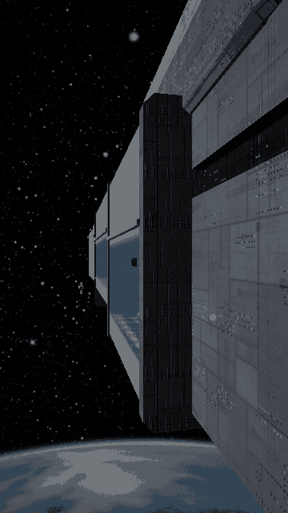

# Along a giant ship

<!-- Generated by `vidgen gallery`; edit src/vidgen/data/gallery/showcases/carrier_pass.yaml, not this file. -->

**Use it for:** a pass along a dressed 3.2 km ship over the Earth, a 50 m craft beside it for size.

A showcase of [`space`](space.md): a small scene written for the gallery, a whole `video.yaml`. Copy it into a
project and run `vidgen render`; until `vidgen tts` voices it, its beats are timed by their word count.

The scene playing, 16:9 and 9:16:

<picture><source media="(prefers-reduced-motion: reduce)" srcset="media/carrier_pass-16x9.png"></picture> <picture><source media="(prefers-reduced-motion: reduce)" srcset="media/carrier_pass-9x16.png"></picture>

Last beat:

 

## YAML

```yaml
title: Along a giant ship
scenes:
  - id: carrier_pass
    type: space
    duration: 5
    params:
      orbits: {central: earth, speedup: 1, bodies: [{name: Carrier, altitude: 900 km}]}
      bodies: [{name: Earth}]
      sun: {direction: [0.3, 0.25, 0.9]}
      craft:
        - {name: Carrier, hull: carrier, seed: 1, length: 3200, dress: {plumes: bank}, scale_ref: {kind: ship, at: hangar-2}}   # an invented 3.2 km ship, a 50 m craft beside it
      camera: {move: hull-pass, ship: Carrier, side: port, standoff: 60, from: 0.3, speed: 40}   # a 16 mm lens 60 m off the wall
```

[All web scenes](README.md) · [All scene types](../README.md) · `vidgen guide space-scenes` · [the space cookbook](../../COOKBOOK-SPACE.md) · [the air cookbook](../../COOKBOOK-AIR.md)
