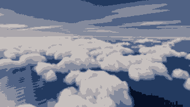
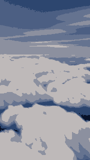
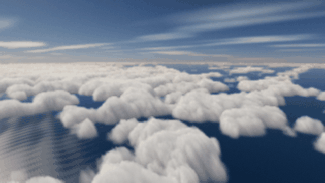
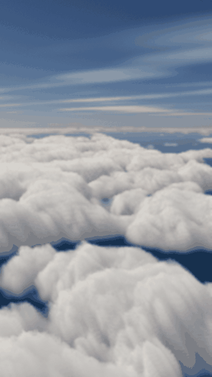

# From orbit to the sea

<!-- Generated by `vidgen gallery`; edit src/vidgen/data/gallery/showcases/orbit_to_sea.yaml, not this file. -->

**Use it for:** a descent in one shot from 400 km through the air to the cloud decks and the sea.

A showcase of [`space`](space.md): a small scene written for the gallery, a whole `video.yaml`. Copy it into a
project and run `vidgen render`; until `vidgen tts` voices it, its beats are timed by their word count.

The scene playing, 16:9 and 9:16:

<picture><source media="(prefers-reduced-motion: reduce)" srcset="media/orbit_to_sea-16x9.png"></picture> <picture><source media="(prefers-reduced-motion: reduce)" srcset="media/orbit_to_sea-9x16.png"></picture>

Last beat:

 

## YAML

```yaml
title: From orbit to the sea
scenes:
  - id: orbit_to_sea
    type: space
    duration: 8
    params:
      world: {planet: earth, at: [8, -150], sun: [38, 250], sea: {state: breeze, seed: 3}, clouds: {sky: fair, seed: 4}}
      camera: {move: descend, from: 400 km, to: 4000, heading: 300, turn: 30, speed: 150, lens: [normal, wide]}   # one shot, no cut: the globe, the decks, the sea
```

[All web scenes](README.md) · [All scene types](../README.md) · `vidgen guide space-scenes` · [the space cookbook](../../COOKBOOK-SPACE.md) · [the air cookbook](../../COOKBOOK-AIR.md)
