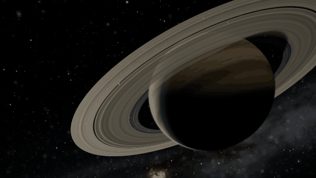
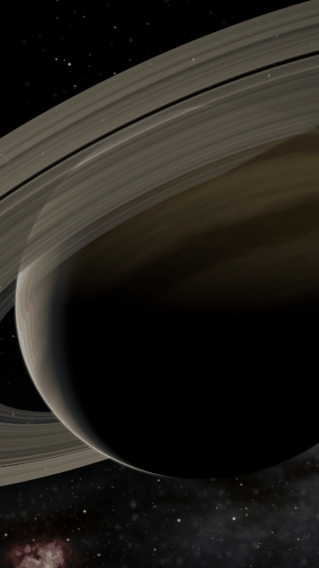
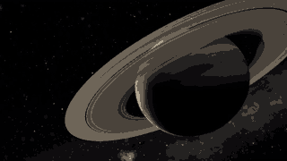
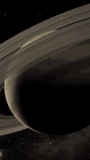

# `space`

<!-- Generated by `vidgen gallery`; edit the sample in AGENTS.md (or video.yaml), not this file. -->

**Use it for:** space with no code: a sky, a sun, planets with rings and air, craft on a real transfer, a black hole, a jump to warp, camera moves on bar lines; true positions and timing from orbit data (`vidgen guide space-scenes`).

A space scene written in YAML alone: `sky` (from a seed, or the real bright stars), `sun`, `bodies` (ready-made worlds or your own, free-standing or the bodies of `orbits`, the orbit data of the `orbit` scene's words, true positions and timing), `scale` (true, enlarged, log), `light` (exposure, eclipses), `craft` (invented spacecraft, flying a body of the orbit data with its burns), `phenomena` (black hole, wormhole, warp, asteroids, comet, aurora), `camera` (moves of vidgen/space-camera, one after another, in seconds or bars), `finish` (space-safe: no FXAA), `music` (pulses, glows and glints; never the camera), `title` and `end_card`; `script` adds your own code. vidgen writes the page and draws it in headless Chromium as a `web` scene, full-bleed; `vidgen space-page` writes it out as a `web` scene to go on in code.

Last beat, 16:9 and 9:16:

 

The scene playing (GIF, up to its last beat):

 

## YAML

From the author guide (`vidgen guide scenes`):

```yaml
- id: rings
  type: space          # no code: the page is written for you (see the space-scenes topic of the guide)
  params:
    sky: {seed: 4, look: rich}
    sun: {direction: [1, -0.3, 0.25]}
    bodies: [{name: Saturn}]
    camera: {move: arc, subject: Saturn, phase: [three-quarter, crescent], distance: {radii: 6}}
    finish: {grain: 0}   # no film grain (default 0.02): a lighter picture
  beats: [{text: "Round the planet, the Sun goes behind it: a thin crescent."}]
```

## Params

| param | type | default | notes |
|---|---|---|---|
| `seed` | `int` | `1` | The scene's seed: the sky's and the worlds' and craft's when they give none. |
| `sky` | `SkySpec \| bool` | `SkySpec(seed=None, look='natural', stars='seed', nebulae=0, galaxies=0)` | The sky (vidgen/space-sky): {seed, look: natural \| rich \| sparse, stars: seed \| real, nebulae, galaxies, ...its options}, a look, real, or false. |
| `sky.seed` | `int \| None` |  | Another sky for every seed (default: the scene's seed). |
| `sky.look` | `str` | `'natural'` | natural, rich or sparse (option sets of the sky; your own options override them). |
| `sky.stars` | `'seed' \| 'real'` | `'seed'` | seed: an algorithmic sky (the default); real: the bright stars where they really are (the shipped list of well-known stars) and the real Milky Way's plane. |
| `sky.nebulae` | `int \| list[dict[str, Any]]` | `0` | Seeded nebulae (a number, up to 12) or a list of {kind: emission \| reflection \| dark, at, size, ...}. |
| `sky.galaxies` | `int \| list[dict[str, Any]]` | `0` | Painted galaxies in the background (a number, up to 12) or a list of {kind: spiral \| elliptical \| irregular, at, size, tilt, ...}. |
| `sun` | `SunSpec` | `SunSpec(kind='sun', temperature=None, seed=None, direction=None, at=None, radius=None)` | The sun (vidgen/space-light): {kind: sun \| red-dwarf \| orange \| white \| blue-giant, temperature, direction, at, radius, glare, spikes, flare...} or a kind. |
| `sun.kind` | `str` | `'sun'` | red-dwarf, orange, sun, white or blue-giant (a star by temperature). |
| `sun.temperature` | `float \| None` |  | The star's temperature in K, instead of its kind's. |
| `sun.seed` | `int \| None` |  | Another surface for every seed. |
| `sun.direction` | `list[float] \| None` |  | Towards the sun, [x, y, z] in the orbit data's axes (z up), for a sun far away in the sky. Default: with orbits on a date around a planet, where the Sun really is that day; with the Sun in the orbit data, the Sun itself; else [1, 0.25, 0.35]. |
| `sun.at` | `list[Any] \| None` |  | A star you can fly to: where it stands ([x, y, z] lengths; a scene without orbits). |
| `sun.radius` | `Any` |  | Its radius with at (a length; default the Sun's, 695,700 km). |
| `orbits` | `OrbitData \| None` |  | Bodies on their orbits, in the orbit scene's words (orbit_data of a web scene: central, bodies, date, span or speedup, transfer, flyby...). Positions and timing are true. |
| `orbits.central` | `str \| OrbitCentral` | `'sun'` | The central body (the origin): a preset (sun, earth, mars, jupiter, moon...) or {name, gm or mass, radius}. |
| `orbits.central.preset` | `str \| None` |  | A preset body: sun, mercury, venus, earth, moon, mars, jupiter, saturn, uranus, neptune (GM and radius from IAU / JPL). |
| `orbits.central.name` | `str \| None` |  | Its name (default: the preset's); bodies' around and the scene's follow use it. |
| `orbits.central.label` | `str` |  | Text shown next to it (default: its name). |
| `orbits.central.show_label` | `bool` | `True` | Show its label. |
| `orbits.central.gm` | `str \| float \| None` |  | Gravitational parameter GM with its unit ('3.986e14 m^3/s^2'); or give mass. |
| `orbits.central.mass` | `str \| float \| None` |  | Mass with its unit ('5.97e24 kg'); GM = G × mass (CODATA 2022 G). |
| `orbits.central.radius` | `str \| float \| None` |  | Radius with its unit ('6371 km'): drawn to scale when it is large enough to see; a periapsis inside it is refused. |
| `orbits.central.color` | `color \| None` |  | Colour (default: the preset's, else highlight). |
| `orbits.bodies` | `list[OrbitBody]` |  | The orbiting bodies, as in the orbit scene: [{preset: earth}, {preset: moon, around: Earth}, {name: Probe, a: '1.5 AU', e: 0.4}, {name: Ship, alongside: Earth}]; its drawing keys (trail, geometry, sectors...) are accepted and not used. |
| `orbits.bodies.name` | `str \| None` |  | Its name (default: the preset's); targets body:<name> and orbit:<name>, around and follow use it. |
| `orbits.bodies.preset` | `str \| None` |  | A preset orbit: mercury … neptune (JPL J2000 elements), moon, iss (420 km, 51.6°), geo (geostationary), halley; elements you give override the preset's. |
| `orbits.bodies.around` | `str \| None` |  | The body it orbits (another body's name; default: the central body, or the preset's primary). |
| `orbits.bodies.a` | `str \| float \| None` |  | Semi-major axis with its unit ('1.52 AU'); for a hyperbola \|a\|. |
| `orbits.bodies.e` | `float \| None` |  | Eccentricity: 0 a circle, below 1 an ellipse, 1 a parabola (escape), above 1 a hyperbola (default 0). |
| `orbits.bodies.periapsis` | `str \| float \| None` |  | Closest distance to the centre of what it orbits ('6778 km'); with apoapsis, or e. |
| `orbits.bodies.apoapsis` | `str \| float \| None` |  | Farthest distance (an ellipse); with periapsis, or e. |
| `orbits.bodies.altitude` | `str \| float \| None` |  | Height of the periapsis above the surface ('420 km'); a circle unless e is given. |
| `orbits.bodies.i` | `str \| float \| None` |  | Inclination (degrees, or '0.9 rad'); the picture shows the orbit seen from above its reference plane. |
| `orbits.bodies.raan` | `str \| float \| None` |  | Longitude of the ascending node Ω (degrees). |
| `orbits.bodies.argp` | `str \| float \| None` |  | Argument of periapsis ω (degrees): where the periapsis lies, measured from the node (from +x when i = 0). |
| `orbits.bodies.nu` | `str \| float \| None` |  | True anomaly at the start (degrees from periapsis; default 0: it starts at periapsis). |
| `orbits.bodies.mean_anomaly` | `str \| float \| None` |  | Mean anomaly at the start (degrees), instead of nu. |
| `orbits.bodies.r` | `list[str \| float] \| None` |  | Start position relative to what it orbits, instead of elements: ['1 AU', 0] or [x, y, z] with units. |
| `orbits.bodies.v` | `list[str \| float] \| None` |  | Start velocity with r: [0, '29.8 km/s']. |
| `orbits.bodies.gm` | `str \| float \| None` |  | Its own gravitational parameter (matters for n-body and adds to its parent's in μ = G(M + m)); default 0 (a probe) or the preset's. |
| `orbits.bodies.mass` | `str \| float \| None` |  | Its mass instead of gm ('7.35e22 kg'). |
| `orbits.bodies.radius` | `str \| float \| None` |  | Its radius ('1737 km'); drawn to scale when large enough. |
| `orbits.bodies.label` | `str` |  | Text shown next to it (default: its name). |
| `orbits.bodies.show_label` | `bool` | `True` | Show its label. |
| `orbits.bodies.color` | `color \| None` |  | Colour (default: the palette by position). |
| `orbits.bodies.trail` | `bool \| float \| str` | `True` | A fading trail behind it: true (a quarter of its orbit), a share of its orbit (0.5), a time ('30 d') or false. |
| `orbits.bodies.orbit` | `bool` | `True` | Draw its orbit (the conic of its Kepler orbit, dashed for an open one). |
| `orbits.bodies.geometry` | `bool \| list['foci' \| 'axes' \| 'apsides']` | `False` | The ellipse's geometry (an orbit with e < 1): true for all of it, or some of foci (the empty focus F′ and the centre C), axes (a and b with their lengths), apsides (periapsis and apoapsis with their names and distances: perihelion / aphelion, perigee / apogee...). |
| `orbits.bodies.sectors` | `bool \| int \| OrbitSectors` | `False` | Kepler's second law: shaded sectors swept in equal times (true: 8 per orbit; a number; or {count, show}), each one's area computed and listed. |
| `orbits.bodies.sectors.count` | `int` | `8` | How many equal times one orbit is cut into (each Δt = period / count). |
| `orbits.bodies.sectors.show` | `'alternate' \| 'all'` | `'alternate'` | alternate: every other sector shaded (gaps between them, the textbook picture); all: every one, in two alternating tints. |
| `orbits.bodies.velocity` | `bool \| OrbitVelocity` | `False` | Velocity vectors (length ∝ speed, one scale for the scene, with a key) and the speed from vis-viva: true, or {live, along, readout}. |
| `orbits.bodies.velocity.live` | `bool` | `True` | An arrow on the moving body, turning and stretching with its velocity. |
| `orbits.bodies.velocity.along` | `int` | `0` | Also this many fixed arrows along the orbit at equal times (crowded where it is slow, long where it is fast). |
| `orbits.bodies.velocity.readout` | `bool` | `True` | The speed now (vis-viva, v² = μ(2/r − 1/a)) and its range, fastest at periapsis, in the readout. |
| `orbits.bodies.alongside` | `str \| None` |  | Start where another body listed before is, moving with it ('Earth': a spacecraft leaving with the planet), instead of elements. |
| `orbits.bodies.burns` | `list[OrbitBurn]` |  | Impulsive burns, in time order: [{at: '45 min', prograde: '0.5 km/s'}, {at: apoapsis, prograde: '0.4 km/s'}]; each Δv drawn as an arrow at its point, the orbits before and after. |
| `orbits.bodies.burns.at` | `str \| float` | `0.0` | When: a time from the start ('45 min'; 0 the start), or periapsis / apoapsis (the next one after the burn before). |
| `orbits.bodies.burns.prograde` | `str \| float \| None` |  | Δv along the velocity ('2.4 km/s'): faster, the far side of the orbit rises. |
| `orbits.bodies.burns.retrograde` | `str \| float \| None` |  | Δv against the velocity: slower, the far side sinks. |
| `orbits.bodies.burns.radial` | `str \| float \| None` |  | Δv in the orbit's plane, perpendicular to the velocity, outwards: turns the orbit (the apsides move). |
| `orbits.bodies.burns.anti_radial` | `str \| float \| None` |  | Δv in the plane, perpendicular to the velocity, inwards. |
| `orbits.bodies.burns.normal` | `str \| float \| None` |  | Δv out of the plane, along the angular momentum: tilts the orbit (a plane change; seen from above the picture shows only its projection). |
| `orbits.bodies.burns.anti_normal` | `str \| float \| None` |  | Δv out of the plane the other way. |
| `orbits.bodies.burns.label` | `str` |  | Text next to its Δv arrow (default: Δv₁ 2.43 km/s prograde). |
| `orbits.bodies.near` | `'L1' \| 'L2' \| 'L3' \| 'L4' \| 'L5' \| None` |  | With a three-body system: start at this Lagrange point (L1…L5), at rest in the rotating frame (a Trojan near L4). |
| `orbits.bodies.shift` | `list[float \| str] \| None` |  | With near: move the start by [x, y] in the rotating frame (x away from the primary along the line to the secondary): numbers are shares of the separation (0.004), or lengths ('0.02 AU'). |
| `orbits.bodies.drift` | `list[float \| str] \| None` |  | With near: a starting velocity [x, y] in the rotating frame: numbers are shares of the secondary's orbital speed, or speeds ('0.1 km/s'). |
| `orbits.bodies.curvature` | `bool` | `False` | Check which way its path bends around the central body (the Moon's path around the Sun is always concave towards it): the result in the panel. |
| `orbits.span` | `str \| float \| None` |  | Simulated time the scene shows, from its first frame to its end ('1 yr', '92 min'); or orbits, or speedup. |
| `orbits.orbits` | `float \| None` |  | Simulated time in periods of the first body (default 1 when neither span nor speedup is given). |
| `orbits.speedup` | `float \| None` |  | Simulated seconds per second of the scene (86400: a day a second), instead of span. |
| `orbits.date` | `str \| date \| None` |  | The date of the first frame ('2026-11-17', 1800-2050): the planet presets are placed by JPL's approximate elements on that day and the bodies turn as they do on it; default J2000.0 (2000-01-01 12:00 TT), the presets' own epoch. |
| `orbits.dynamics` | `'kepler' \| 'nbody'` | `'kepler'` | kepler: each body on its two-body orbit around its parent; nbody: every body with mass pulls on every other. |
| `orbits.method` | `str` | `'leapfrog'` | n-body method: leapfrog or rk45. |
| `orbits.step` | `str \| float \| None` |  | n-body leapfrog step ('1 h'). |
| `orbits.transfer` | `OrbitTransfer \| None` |  | A transfer flown by one body (as in the orbit scene): {kind: hohmann, ship: Ship, to: Mars}; the ship's path and burns are in the data. |
| `orbits.transfer.kind` | `'hohmann' \| 'bielliptic' \| 'phasing'` | `'hohmann'` | hohmann (two burns, half an ellipse), bielliptic (three burns, out to apoapsis and back in), phasing (catch up a body on the same orbit). |
| `orbits.transfer.ship` | `str` | required | The body that flies it (listed in bodies, on a circular orbit; alongside: Earth starts it with a planet). |
| `orbits.transfer.to` | `str \| float` | required | Where to: a body's name (its orbit circular and in the same plane: the phase angle and launch windows then count) or a radius ('42164 km'). |
| `orbits.transfer.depart` | `str \| float` | `'window'` | When the first burn fires: window (the first launch window from the start, when the target leads by the right angle), or a time ('30 d'). |
| `orbits.transfer.apoapsis` | `str \| float \| None` |  | bielliptic: the far point between the two burns ('300000 km'), beyond both orbits. |
| `orbits.transfer.revolutions` | `int` | `1` | phasing: turns on the phasing orbit before the second burn (more turns: a gentler orbit). |
| `orbits.flyby` | `OrbitFlyby \| None` |  | A gravity assist past the central body (as in the orbit scene), in the planet's frame; the probe is a body of the data. |
| `orbits.flyby.v_inf` | `str \| float` | required | The probe's speed relative to the planet far away (hyperbolic excess speed, '5.6 km/s'): the same in and out. |
| `orbits.flyby.periapsis` | `str \| float \| None` |  | Closest distance to the planet's centre ('400000 km'); or altitude. |
| `orbits.flyby.altitude` | `str \| float \| None` |  | Closest height above the surface ('200000 km'). |
| `orbits.flyby.side` | `'behind' \| 'in_front'` | `'behind'` | behind: the probe passes behind the planet (on the side it comes from) and gains speed around the Sun; in_front: it loses speed. |
| `orbits.flyby.angle` | `str \| float` | `150.0` | Direction of v∞ coming in, in degrees from the planet's motion (180: straight against it; 150: mostly from ahead). |
| `orbits.flyby.planet_speed` | `str \| float \| None` |  | The planet's speed around the Sun ('13.06 km/s'); default: a preset planet's circular speed at its mean distance. |
| `orbits.flyby.atmosphere` | `str \| float \| None` |  | Height of the top of the atmosphere ('100 km'): a periapsis in it is refused. |
| `orbits.flyby.name` | `str` | `'Probe'` | The probe's name (target body:<name>). |
| `orbits.flyby.reach` | `float \| None` |  | How far out the pass starts and ends, in periapsis distances; default: far enough to show where the asymptotes cross (at least 6). |
| `orbits.flyby.vectors` | `bool` | `True` | Draw the Sun-frame vector diagram: the planet's velocity plus v∞ before and after. |
| `orbits.system` | `OrbitSystem \| None` |  | A restricted three-body pair or the figure-eight (as in the orbit scene). |
| `orbits.system.preset` | `str \| None` |  | earth_moon, sun_earth (the Sun with the Earth–Moon barycentre), sun_jupiter (restricted three-body pairs) or figure_eight (three equal masses). |
| `orbits.system.primary` | `str \| None` |  | The larger body of a pair of your own (a preset body: sun, earth, jupiter...). |
| `orbits.system.secondary` | `str \| None` |  | The smaller body of the pair (a preset body); it goes round the primary on a circle. |
| `orbits.system.mu` | `float \| None` |  | The mass ratio μ = m₂/(m₁ + m₂) instead of the bodies' own (the secondary's mass is set from it): L4 and L5 are stable below 0.0385 (Routh). |
| `orbits.system.separation` | `str \| float \| None` |  | The distance between the primaries ('5.2 AU'); default: the secondary preset's mean distance. |
| `orbits.system.mass` | `str \| float \| None` |  | figure_eight: each body's mass ('1 Msun'). |
| `orbits.system.scale` | `str \| float \| None` |  | figure_eight: the length the published unit stands for ('1 AU'): the eight is about 2.2 of it wide. |
| `orbits.planes` | `dict[str, 'equator' \| 'ecliptic']` |  | What a body's i, raan and argp are measured from, by name: equator (the equator of the body it orbits) or ecliptic. Default: the preset's (iss, geo and the Galilean moons the equator; the planets, the Moon and Halley the ecliptic); a body of your own around a planet or moon the equator, around the Sun the ecliptic. |
| `orbits.path_samples` | `int` | `256` | Points of each body's path over the scene (the polyline ctx.orbits.path gives). |
| `scale` | `ScaleSpec \| None` |  | With orbits: true (default), {mode: enlarged, enlarge: 50}, a factor (enlarged by it) or log; the scene says so (space.note()). |
| `scale.mode` | `'true' \| 'enlarged' \| 'log'` | `'true'` | true: sizes and distances as they are; enlarged: bodies drawn larger by a stated factor (the note says so); log: distances compressed as the orbit scene's radial: log. |
| `scale.enlarge` | `float \| dict[str, float]` | `1.0` | The factor of enlarged (a number, or {default: 50, Sun: 5} per body). |
| `scale.note` | `bool` | `True` | Say it on screen: the orbit scene's words ("sizes not to scale · bodies enlarged 50×; distances to scale", "distances compressed (log)") in a corner; false leaves it to the narration. |
| `bodies` | `list[BodySpec]` |  | Worlds (vidgen/space-bodies): [{name: Saturn}, {name: Moon, world: moon, at: ['400000 km', 0, 0]}, {name: Mira, type: ocean, seed: 7, rings: true}]. |
| `bodies.name` | `str` | required | Its name: the body of the orbit data it shows (with orbits), and what the camera and the music name. |
| `bodies.world` | `str \| None` |  | A ready-made world (earth, saturn, moon, tempest, ochre...); default the name's, when it is one. |
| `bodies.type` | `str \| None` |  | Or a world of your own of this surface type: rocky, icy, desert, ocean, lava, gas, ice-giant. |
| `bodies.seed` | `int \| None` |  | Another surface for every seed. |
| `bodies.rings` | `bool \| dict[str, Any] \| None` |  | Rings: true, false, or {inner, outer (radii), style: broad \| narrow, gaps, color, opacity, dust, seed}; a ready-made world keeps its own unless changed. |
| `bodies.air` | `bool \| str \| dict[str, Any] \| None` |  | Air: false, a kind (earth, mars, venus, titan, giant, ice, thin, smoke) or {like, density, height...}; true scale heights unless height says otherwise. |
| `bodies.spin` | `bool \| str \| float \| None` |  | true: the body's own turning from the orbit data (the default there), locked: no turning, or seconds of film for a turn (a stated artistic rate). |
| `bodies.tilt` | `float \| None` |  | Degrees the pole leans (a scene without orbits; with orbits the data's pole). |
| `bodies.at` | `list[Any] \| None` |  | Where it stands, [x, y, z] lengths (a scene without orbits; default [0, 0, 0]). |
| `bodies.radius` | `Any` |  | Its radius (a length; a scene without orbits; default the real body's for a ready-made lookalike, else 6,000 km). |
| `light` | `LightSpec` | `LightSpec(exposure='film', ev=0, falloff=0, eclipses=False, shadows=False, shine=1, ambient=0)` | The light (vidgen/space-light): {exposure: film \| camera \| auto, ev, falloff, eclipses, shadows, shine, ambient, ...}. |
| `light.exposure` | `str` | `'film'` | film (a film's convention: day sides and stars in one frame; default), camera (honest, ev stops) or auto (honest, metered). |
| `light.ev` | `float` | `0` | Stops over a sunlit ground's exposure, with camera or auto. |
| `light.falloff` | `float` | `0` | 0: the sun as bright everywhere (stated artistic default); 2: the inverse-square law from reference. |
| `light.eclipses` | `bool` | `False` | Soft eclipse shadows of bodies on bodies. |
| `light.shadows` | `bool` | `False` | Shadow maps for the craft (their own parts and each other). |
| `light.shine` | `float` | `1` | Planet-shine on the night sides (0: black). |
| `light.ambient` | `float` | `0` | An ambient light (none by default). |
| `craft` | `list[CraftSpec]` |  | Craft (vidgen/space-craft): [{name: Ship, kind: ship, fly: Ship}, {name: Probe, kind: probe, at: [0, 0, 0]}]. |
| `craft.name` | `str` | required | Its name (what the camera follows and the music names). |
| `craft.kind` | `str \| list[str]` | `'probe'` | probe, satellite, station, ship, lander or tug (invented designs); a list of kinds for a fleet. |
| `craft.seed` | `int \| None` |  | Another design of the kind for every seed. |
| `craft.detail` | `str` | `'near'` | near (everything) or far (a third of the triangles: for the distance and fleets). |
| `craft.fly` | `str \| None` |  | The body of the orbit data it flies (its position, velocity and burns); default its own name when the data has it. |
| `craft.attitude` | `str \| list[dict[str, Any]] \| None` |  | prograde, retrograde, radial, nadir, sun, target, thrust or inertial, or a list of {at, attitude, turn} (default prograde when it flies or moves). |
| `craft.burn` | `bool \| dict[str, Any]` | `True` | How the data's burns are shown: true, false, or {seconds: 2, turn: 3, attitude: thrust} (thrust for seconds centred on each impulsive burn). |
| `craft.target` | `str \| None` |  | A body or craft the dishes point at (and attitude target). |
| `craft.throttle` | `float \| None` |  | The engines, 0..1 (default: the burns of the orbit data; music: can drive it). |
| `craft.rcs` | `float \| None` |  | The thrusters, 0..1 (default: puffs at the turns). |
| `craft.lights` | `float \| None` |  | The lights' strength (1). |
| `craft.marker` | `float` | `0` | A point of at least this many pixels when the craft is too small to see (a stated departure from true size). |
| `craft.at` | `list[Any] \| None` |  | Where it stands, [x, y, z] lengths (a scene without orbits). |
| `craft.velocity` | `list[float] \| None` |  | Its velocity (m/s, [x, y, z]) standing free: it moves on a straight line from at. |
| `craft.fleet` | `int \| None` |  | Not one craft but this many (seeds seed, seed + 1, ...) in a loose formation. |
| `craft.spacing` | `Any` |  | The fleet's spacing (a length; default 2.5 times the first craft's radius). |
| `phenomena` | `list[PhenomenonSpec]` |  | Phenomena (vidgen/space-phenomena): [{kind: black-hole, size: '10 km'}, {kind: warp, over: [4, 7]}, {kind: aurora, world: Earth}]. |
| `phenomena.kind` | `str` | required | black-hole, wormhole, warp, asteroids, asteroid, comet or aurora. |
| `phenomena.name` | `str \| None` |  | Its name (what the camera and the music name; default its kind). |
| `phenomena.at` | `list[Any] \| None` |  | Where it stands, [x, y, z] lengths (default [0, 0, 0]); not for a warp, a field of asteroids or an aurora. |
| `phenomena.size` | `Any` |  | Its unit as a length: a black hole's horizon radius, a wormhole's throat, a rock's or a comet's scale; metres per unit of an asteroid belt (default: a sixteenth of the radius of the body it goes round). |
| `phenomena.world` | `str \| None` |  | aurora: the world it shines on. |
| `phenomena.around` | `str \| None` |  | asteroids with layout belt: the world it goes round. |
| `phenomena.body` | `str \| None` |  | comet: the body of the orbit data it is (it grows near the sun). |
| `phenomena.over` | `list[Any] \| None` |  | warp: [start, end] of the jump (seconds or 'bar 9'); default the whole scene. |
| `phenomena.other` | `dict[str, Any] \| None` |  | wormhole: the sky on the other side (sky options: {seed: 11, look: rich}). |
| `camera` | `list[MoveSpec]` |  | Camera moves (vidgen/space-camera), one after another: [{move: arc, subject: Saturn, over: [0, 8], phase: [three-quarter, crescent]}]; one move takes the whole scene. |
| `camera.move` | `str` | required | arc, fly-by, pass, arrive, reveal, follow, zoom or look. |
| `camera.subject` | `str \| None` |  | What it looks at, flies by or follows: a body, craft or phenomenon by name. |
| `camera.over` | `list[Any] \| None` |  | [start, end] of the move: seconds of the scene, or places in the song ('bar 9', 'bar 13 beat 3') with music_data; default the whole scene for one move. |
| `camera.lens` | `str \| float \| None` |  | A lens by name (ultra-wide 16 mm, wide 24, wide-normal 35, normal 50, portrait 85, long 135, tele 300, long-tele 600) or in mm. |
| `camera.cut` | `bool` | `False` | A cut into this move: it need not start where the move before left the camera. |
| `finish` | `FinishSpec \| bool` | `FinishSpec(bloom={'strength': 0.3, 'radius': 0.5, 'threshold': 1.0}, grain=0.02, vignette=0.3, grade={}, motion_blur=False, depth_of_field=False, antialias='none')` | Finishing (vidgen/three-finish): {bloom, grade, grain, vignette, motion_blur, depth_of_field, antialias: none}, or false (straight to the canvas). |
| `finish.bloom` | `bool \| float \| dict[str, Any]` | `{'strength': 0.3, 'radius': 0.5, 'threshold': 1.0}` | Glow round the brightest light: a strength (0.3), true, false, or {strength, radius, threshold, scale}. |
| `finish.grain` | `float` | `0.02` | Film grain. |
| `finish.vignette` | `bool \| float \| dict[str, Any]` | `0.3` | Darker corners: an amount, false, or {amount, inner, outer}. |
| `finish.grade` | `dict[str, Any]` |  | Colour grade: {temperature, tint, saturation, contrast, lift, gamma, gain, filter}. |
| `finish.motion_blur` | `bool \| int \| dict[str, Any]` | `False` | Samples across a 180 degree shutter (3 to 5), true (5) or {samples, shutter}: costs a frame that many times. |
| `finish.depth_of_field` | `bool \| dict[str, Any]` | `False` | true, or {f_stop, max_blur, quality}: focused on the camera move's subject (shot.focus), every frame. |
| `finish.antialias` | `'none' \| 'fxaa'` | `'none'` | none (space-safe default: FXAA makes small crosses of stars and dots of thin rings) or fxaa. |
| `music` | `list[ReactionSpec]` |  | Reactions to the score: [{track: kick, pulse: Sun}, {track: level, glow: Ship}, {track: hook, glint: Station}] (needs music_data). |
| `music.track` | `str` | required | A track of the score, or level (the measured level of the video's music). |
| `music.pulse` | `str \| None` |  | A brightness pulse on each hit of the track, of this thing (a star's glare, the sky, a black hole, a warp; a craft's lights). Never the camera. |
| `music.glow` | `str \| None` |  | A level that follows how strongly the track sounds, of this thing (a craft: its throttle). |
| `music.glint` | `str \| None` |  | A glint on each note, of this thing (a craft: its lights). |
| `music.as` | `'lights' \| 'throttle' \| 'rcs' \| None` |  | For a craft: what the reaction drives instead (lights, throttle or rcs). |
| `music.amount` | `float` | `0.6` | How strong: the share the brightness grows by at a full hit (0.6), or a craft's value at full. |
| `music.decay` | `float` | `0.18` | Seconds a pulse or a glint takes to fall to a third. |
| `music_data` | `bool \| MusicDataSettings` | `False` | The video's music for the page as ctx.music (as on a web scene): needed by music: and by times in bars. |
| `music_data.bands` | `int` | `16` | Spectrum bands, log-spaced from 40 Hz to 12 kHz (1 to 64). |
| `music_data.tracks` | `list[str] \| None` |  | Only these score tracks' hits and notes (default: every track). |
| `music_data.t0` | `float \| None` |  | Song time (seconds into the music) at the scene's start, instead of the one vidgen works out. |
| `title` | `CardSpec \| None` |  | An opening title (vidgen/title-cards): text, or {title, subtitle, side, start, hold, ...}. |
| `title.title` | `str` | required | The card's title. |
| `title.subtitle` | `str` |  | The line under it. |
| `title.lines` | `list[str]` |  | An end card's further lines. |
| `end_card` | `CardSpec \| None` |  | An end card (vidgen/title-cards): {title, subtitle, lines, link, side, start, ...}. |
| `end_card.title` | `str` | required | The card's title. |
| `end_card.subtitle` | `str` |  | The line under it. |
| `end_card.lines` | `list[str]` |  | An end card's further lines. |
| `script` | `str \| None` |  | Your code: a JavaScript module of the project whose setup(S) runs once after the scene is built and frame(t, S) every frame (S: every object by name). |
| `data` | `dict[str, Any]` |  | Values for your script, as ctx.data. |
| `fade` | `bool` | `True` | false: no 0.5 s fade-out at the end (scenes cut straight into each other on bar lines). |

## Targets

`view`

## Beats

Any number.

[All web scenes](README.md) · [All scene types](../README.md) · `vidgen list-scenes` · `vidgen schema --scene space`
