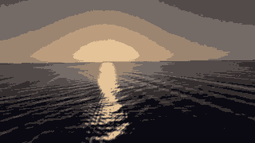
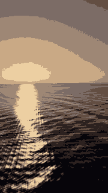
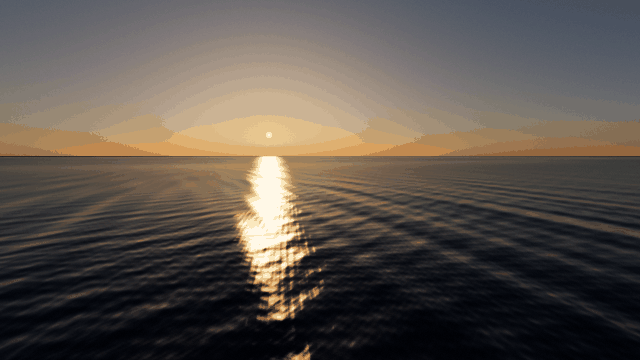
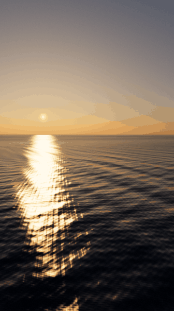

# A skim at sunset

<!-- Generated by `vidgen gallery`; edit src/vidgen/data/gallery/showcases/sunset_skim.yaml, not this file. -->

**Use it for:** a surface scene: a world's own air and sea, 14 m over the water towards a low sun.

A showcase of [`space`](space.md): a small scene written for the gallery, a whole `video.yaml`. Copy it into a
project and run `vidgen render`; until `vidgen tts` voices it, its beats are timed by their word count.

The scene playing, 16:9 and 9:16:

<picture><source media="(prefers-reduced-motion: reduce)" srcset="media/sunset_skim-16x9.png"></picture> <picture><source media="(prefers-reduced-motion: reduce)" srcset="media/sunset_skim-9x16.png"></picture>

Last beat:

 

## YAML

```yaml
title: A skim at sunset
scenes:
  - id: sunset_skim
    type: space
    duration: 6
    params:
      world: {sea: {state: breeze, seed: 3}, sun: [3, 290]}                      # one world: its air, its sea; the sun 3 degrees up
      camera: {move: skim, heading: 284, speed: 90, clearance: 14, turn: 14, lens: wide}   # 14 m over the water at 90 m/s, banking into a turn
```

[All web scenes](README.md) · [All scene types](../README.md) · `vidgen guide space-scenes` · [the space cookbook](../../COOKBOOK-SPACE.md) · [the air cookbook](../../COOKBOOK-AIR.md)
