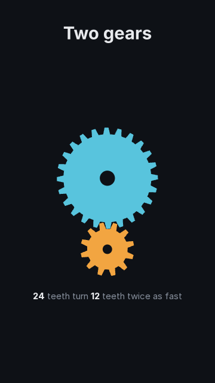
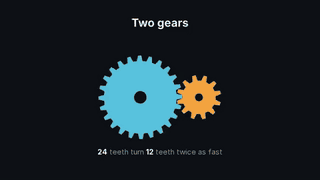
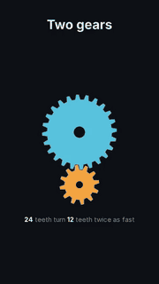

# `web`

<!-- Generated by `vidgen gallery`; edit the sample in AGENTS.md (or video.yaml), not this file. -->

**Use it for:** a picture or animation no built-in draws, written yourself in HTML, CSS and JavaScript: a bespoke layout, CSS or SVG animation, a canvas drawing, your own three.js scene (`vidgen guide web`).

A page written in HTML, CSS and JavaScript, shown full-bleed (`region: bleed`) or in the body region under a title (`region: body`; the page is laid out at that region's size): `page:` names an HTML file of the project (any HTML, CSS and JavaScript; relative links work) or `script:` a JavaScript module that vidgen loads into a bare page with one canvas filling the frame. Time belongs to vidgen: the page's timers, `requestAnimationFrame`, `Date`, CSS, SVG and video animations follow the video's time and `Math.random` is seeded from the scene id, so ordinary web code renders the same every time. Optional hooks: `load(ctx)` once before frame 0 and `frame(t, ctx)` before each screenshot (`t`: seconds from the scene's start; a page sets `window.vidgen = {load, frame}`, a script exports them). The page is given the theme (`ctx.theme` and CSS variables such as `var(--vidgen-primary)`, with the bundled fonts), `data:` (`ctx.data`) and the narration beats (`ctx.beats`; `<body data-beat="b2">` and a `vidgen-beat` event); `import * as THREE from "three"` loads the bundled three.js; `ctx.aspect` (`16:9`, `9:16`...) and `<html data-aspect="9:16" data-orientation="portrait">` let one page lay itself out for each shape of the video. What the page leaves transparent (a page without a background, the bare page of a script) shows the video's background. A page built in fixed pixels needs no rewrite: `design_width: 1280` lays it out in a window that wide and draws it at the video's size. Nothing is fetched from the internet. The page is on screen from the first frame, beat 1 fades the title in, the scene fades out at the end. Drawn in headless Chromium (once: `python -m playwright install chromium`).

Last beat, 16:9 and 9:16:

 

The scene playing (GIF, up to its last beat):

 

## YAML

From the author guide (`vidgen guide scenes`):

```yaml
- id: gears
  type: web
  params: {page: extensions/gears.html, region: body, title: "Two gears"}   # or script: extensions/gears.js (one canvas)
  beats: [{text: "Two gears turn together."}]
```

## Params

| param | type | default | notes |
|---|---|---|---|
| `page` | `str \| None` |  | An HTML file in the project folder (`extensions/gears.html`): any HTML, CSS and JavaScript; relative links to styles, pictures, fonts and modules are served from the project folder. |
| `script` | `str \| None` |  | A JavaScript module in the project folder (`extensions/gears.js`), loaded into a bare page with one canvas (`id="vidgen-canvas"`, the page's size; also `ctx.canvas`) on a transparent background (what it does not draw shows the video's background). |
| `title` | `str` |  | Heading drawn by vidgen: on a plate over the top of the page with region: bleed, above it with region: body. (also: heading) |
| `region` | `'bleed' \| 'body'` | `'bleed'` | Where the page goes: bleed (the whole frame, edge to edge) or body (the safe area below the title; the page is laid out at that size). |
| `data` | `dict[str, Any]` |  | Values for the page, as the page reads them in `ctx.data` (`{teeth: 24, color: primary}`): text, numbers, true/false, null, lists and mappings; theme colour names are not resolved (the page looks them up in `ctx.theme.colors`). |
| `music_data` | `bool \| MusicDataSettings` | `False` | The video's music for the page as `ctx.music`: `true`, or `{bands: 16, tracks: [kick, hook], t0: 41.6}`. Per video frame: spectrum bands, level, low end and onsets of the music the video plays; from a score file also every track's hits and notes in song time (`ctx.music.t0` is the song time at the scene's start). |
| `music_data.bands` | `int` | `16` | Spectrum bands, log-spaced from 40 Hz to 12 kHz (1 to 64). |
| `music_data.tracks` | `list[str] \| None` |  | Only these score tracks' hits and notes (default: every track). |
| `music_data.t0` | `float \| None` |  | Song time (seconds into the music) at the scene's start, instead of the one vidgen works out. |
| `orbit_data` | `OrbitData \| None` |  | Bodies on their orbits for the page as `ctx.orbits`, in the orbit scene's words: `{bodies: [{preset: earth}, {preset: mars}], span: '1 yr', date: '2026-11-17'}`, or a transfer, a flyby, a system. Per frame of the scene: each body's position and velocity (m, m/s; the ecliptic and equinox of J2000, origin the central body), its rotation (quaternion, prime meridian) for the Sun, the planets, the Moon and the Galilean moons, its path and orbit as polylines, a ship's burns. |
| `orbit_data.central` | `str \| OrbitCentral` | `'sun'` | The central body (the origin): a preset (sun, earth, mars, jupiter, moon...) or {name, gm or mass, radius}. |
| `orbit_data.central.preset` | `str \| None` |  | A preset body: sun, mercury, venus, earth, moon, mars, jupiter, saturn, uranus, neptune (GM and radius from IAU / JPL). |
| `orbit_data.central.name` | `str \| None` |  | Its name (default: the preset's); bodies' around and the scene's follow use it. |
| `orbit_data.central.label` | `str` |  | Text shown next to it (default: its name). |
| `orbit_data.central.show_label` | `bool` | `True` | Show its label. |
| `orbit_data.central.gm` | `str \| float \| None` |  | Gravitational parameter GM with its unit ('3.986e14 m^3/s^2'); or give mass. |
| `orbit_data.central.mass` | `str \| float \| None` |  | Mass with its unit ('5.97e24 kg'); GM = G × mass (CODATA 2022 G). |
| `orbit_data.central.radius` | `str \| float \| None` |  | Radius with its unit ('6371 km'): drawn to scale when it is large enough to see; a periapsis inside it is refused. |
| `orbit_data.central.color` | `color \| None` |  | Colour (default: the preset's, else highlight). |
| `orbit_data.bodies` | `list[OrbitBody]` |  | The orbiting bodies, as in the orbit scene: [{preset: earth}, {preset: moon, around: Earth}, {name: Probe, a: '1.5 AU', e: 0.4}, {name: Ship, alongside: Earth}]; its drawing keys (trail, geometry, sectors...) are accepted and not used. |
| `orbit_data.bodies.name` | `str \| None` |  | Its name (default: the preset's); targets body:<name> and orbit:<name>, around and follow use it. |
| `orbit_data.bodies.preset` | `str \| None` |  | A preset orbit: mercury … neptune (JPL J2000 elements), moon, iss (420 km, 51.6°), geo (geostationary), halley; elements you give override the preset's. |
| `orbit_data.bodies.around` | `str \| None` |  | The body it orbits (another body's name; default: the central body, or the preset's primary). |
| `orbit_data.bodies.a` | `str \| float \| None` |  | Semi-major axis with its unit ('1.52 AU'); for a hyperbola \|a\|. |
| `orbit_data.bodies.e` | `float \| None` |  | Eccentricity: 0 a circle, below 1 an ellipse, 1 a parabola (escape), above 1 a hyperbola (default 0). |
| `orbit_data.bodies.periapsis` | `str \| float \| None` |  | Closest distance to the centre of what it orbits ('6778 km'); with apoapsis, or e. |
| `orbit_data.bodies.apoapsis` | `str \| float \| None` |  | Farthest distance (an ellipse); with periapsis, or e. |
| `orbit_data.bodies.altitude` | `str \| float \| None` |  | Height of the periapsis above the surface ('420 km'); a circle unless e is given. |
| `orbit_data.bodies.i` | `str \| float \| None` |  | Inclination (degrees, or '0.9 rad'); the picture shows the orbit seen from above its reference plane. |
| `orbit_data.bodies.raan` | `str \| float \| None` |  | Longitude of the ascending node Ω (degrees). |
| `orbit_data.bodies.argp` | `str \| float \| None` |  | Argument of periapsis ω (degrees): where the periapsis lies, measured from the node (from +x when i = 0). |
| `orbit_data.bodies.nu` | `str \| float \| None` |  | True anomaly at the start (degrees from periapsis; default 0: it starts at periapsis). |
| `orbit_data.bodies.mean_anomaly` | `str \| float \| None` |  | Mean anomaly at the start (degrees), instead of nu. |
| `orbit_data.bodies.r` | `list[str \| float] \| None` |  | Start position relative to what it orbits, instead of elements: ['1 AU', 0] or [x, y, z] with units. |
| `orbit_data.bodies.v` | `list[str \| float] \| None` |  | Start velocity with r: [0, '29.8 km/s']. |
| `orbit_data.bodies.gm` | `str \| float \| None` |  | Its own gravitational parameter (matters for n-body and adds to its parent's in μ = G(M + m)); default 0 (a probe) or the preset's. |
| `orbit_data.bodies.mass` | `str \| float \| None` |  | Its mass instead of gm ('7.35e22 kg'). |
| `orbit_data.bodies.radius` | `str \| float \| None` |  | Its radius ('1737 km'); drawn to scale when large enough. |
| `orbit_data.bodies.label` | `str` |  | Text shown next to it (default: its name). |
| `orbit_data.bodies.show_label` | `bool` | `True` | Show its label. |
| `orbit_data.bodies.color` | `color \| None` |  | Colour (default: the palette by position). |
| `orbit_data.bodies.trail` | `bool \| float \| str` | `True` | A fading trail behind it: true (a quarter of its orbit), a share of its orbit (0.5), a time ('30 d') or false. |
| `orbit_data.bodies.orbit` | `bool` | `True` | Draw its orbit (the conic of its Kepler orbit, dashed for an open one). |
| `orbit_data.bodies.geometry` | `bool \| list['foci' \| 'axes' \| 'apsides']` | `False` | The ellipse's geometry (an orbit with e < 1): true for all of it, or some of foci (the empty focus F′ and the centre C), axes (a and b with their lengths), apsides (periapsis and apoapsis with their names and distances: perihelion / aphelion, perigee / apogee...). |
| `orbit_data.bodies.sectors` | `bool \| int \| OrbitSectors` | `False` | Kepler's second law: shaded sectors swept in equal times (true: 8 per orbit; a number; or {count, show}), each one's area computed and listed. |
| `orbit_data.bodies.sectors.count` | `int` | `8` | How many equal times one orbit is cut into (each Δt = period / count). |
| `orbit_data.bodies.sectors.show` | `'alternate' \| 'all'` | `'alternate'` | alternate: every other sector shaded (gaps between them, the textbook picture); all: every one, in two alternating tints. |
| `orbit_data.bodies.velocity` | `bool \| OrbitVelocity` | `False` | Velocity vectors (length ∝ speed, one scale for the scene, with a key) and the speed from vis-viva: true, or {live, along, readout}. |
| `orbit_data.bodies.velocity.live` | `bool` | `True` | An arrow on the moving body, turning and stretching with its velocity. |
| `orbit_data.bodies.velocity.along` | `int` | `0` | Also this many fixed arrows along the orbit at equal times (crowded where it is slow, long where it is fast). |
| `orbit_data.bodies.velocity.readout` | `bool` | `True` | The speed now (vis-viva, v² = μ(2/r − 1/a)) and its range, fastest at periapsis, in the readout. |
| `orbit_data.bodies.alongside` | `str \| None` |  | Start where another body listed before is, moving with it ('Earth': a spacecraft leaving with the planet), instead of elements. |
| `orbit_data.bodies.burns` | `list[OrbitBurn]` |  | Impulsive burns, in time order: [{at: '45 min', prograde: '0.5 km/s'}, {at: apoapsis, prograde: '0.4 km/s'}]; each Δv drawn as an arrow at its point, the orbits before and after. |
| `orbit_data.bodies.burns.at` | `str \| float` | `0.0` | When: a time from the start ('45 min'; 0 the start), or periapsis / apoapsis (the next one after the burn before). |
| `orbit_data.bodies.burns.prograde` | `str \| float \| None` |  | Δv along the velocity ('2.4 km/s'): faster, the far side of the orbit rises. |
| `orbit_data.bodies.burns.retrograde` | `str \| float \| None` |  | Δv against the velocity: slower, the far side sinks. |
| `orbit_data.bodies.burns.radial` | `str \| float \| None` |  | Δv in the orbit's plane, perpendicular to the velocity, outwards: turns the orbit (the apsides move). |
| `orbit_data.bodies.burns.anti_radial` | `str \| float \| None` |  | Δv in the plane, perpendicular to the velocity, inwards. |
| `orbit_data.bodies.burns.normal` | `str \| float \| None` |  | Δv out of the plane, along the angular momentum: tilts the orbit (a plane change; seen from above the picture shows only its projection). |
| `orbit_data.bodies.burns.anti_normal` | `str \| float \| None` |  | Δv out of the plane the other way. |
| `orbit_data.bodies.burns.label` | `str` |  | Text next to its Δv arrow (default: Δv₁ 2.43 km/s prograde). |
| `orbit_data.bodies.near` | `'L1' \| 'L2' \| 'L3' \| 'L4' \| 'L5' \| None` |  | With a three-body system: start at this Lagrange point (L1…L5), at rest in the rotating frame (a Trojan near L4). |
| `orbit_data.bodies.shift` | `list[float \| str] \| None` |  | With near: move the start by [x, y] in the rotating frame (x away from the primary along the line to the secondary): numbers are shares of the separation (0.004), or lengths ('0.02 AU'). |
| `orbit_data.bodies.drift` | `list[float \| str] \| None` |  | With near: a starting velocity [x, y] in the rotating frame: numbers are shares of the secondary's orbital speed, or speeds ('0.1 km/s'). |
| `orbit_data.bodies.curvature` | `bool` | `False` | Check which way its path bends around the central body (the Moon's path around the Sun is always concave towards it): the result in the panel. |
| `orbit_data.span` | `str \| float \| None` |  | Simulated time the scene shows, from its first frame to its end ('1 yr', '92 min'); or orbits, or speedup. |
| `orbit_data.orbits` | `float \| None` |  | Simulated time in periods of the first body (default 1 when neither span nor speedup is given). |
| `orbit_data.speedup` | `float \| None` |  | Simulated seconds per second of the scene (86400: a day a second), instead of span. |
| `orbit_data.date` | `str \| date \| None` |  | The date of the first frame ('2026-11-17', 1800-2050): the planet presets are placed by JPL's approximate elements on that day and the bodies turn as they do on it; default J2000.0 (2000-01-01 12:00 TT), the presets' own epoch. |
| `orbit_data.dynamics` | `'kepler' \| 'nbody'` | `'kepler'` | kepler: each body on its two-body orbit around its parent; nbody: every body with mass pulls on every other. |
| `orbit_data.method` | `str` | `'leapfrog'` | n-body method: leapfrog or rk45. |
| `orbit_data.step` | `str \| float \| None` |  | n-body leapfrog step ('1 h'). |
| `orbit_data.transfer` | `OrbitTransfer \| None` |  | A transfer flown by one body (as in the orbit scene): {kind: hohmann, ship: Ship, to: Mars}; the ship's path and burns are in the data. |
| `orbit_data.transfer.kind` | `'hohmann' \| 'bielliptic' \| 'phasing'` | `'hohmann'` | hohmann (two burns, half an ellipse), bielliptic (three burns, out to apoapsis and back in), phasing (catch up a body on the same orbit). |
| `orbit_data.transfer.ship` | `str` | required | The body that flies it (listed in bodies, on a circular orbit; alongside: Earth starts it with a planet). |
| `orbit_data.transfer.to` | `str \| float` | required | Where to: a body's name (its orbit circular and in the same plane: the phase angle and launch windows then count) or a radius ('42164 km'). |
| `orbit_data.transfer.depart` | `str \| float` | `'window'` | When the first burn fires: window (the first launch window from the start, when the target leads by the right angle), or a time ('30 d'). |
| `orbit_data.transfer.apoapsis` | `str \| float \| None` |  | bielliptic: the far point between the two burns ('300000 km'), beyond both orbits. |
| `orbit_data.transfer.revolutions` | `int` | `1` | phasing: turns on the phasing orbit before the second burn (more turns: a gentler orbit). |
| `orbit_data.flyby` | `OrbitFlyby \| None` |  | A gravity assist past the central body (as in the orbit scene), in the planet's frame; the probe is a body of the data. |
| `orbit_data.flyby.v_inf` | `str \| float` | required | The probe's speed relative to the planet far away (hyperbolic excess speed, '5.6 km/s'): the same in and out. |
| `orbit_data.flyby.periapsis` | `str \| float \| None` |  | Closest distance to the planet's centre ('400000 km'); or altitude. |
| `orbit_data.flyby.altitude` | `str \| float \| None` |  | Closest height above the surface ('200000 km'). |
| `orbit_data.flyby.side` | `'behind' \| 'in_front'` | `'behind'` | behind: the probe passes behind the planet (on the side it comes from) and gains speed around the Sun; in_front: it loses speed. |
| `orbit_data.flyby.angle` | `str \| float` | `150.0` | Direction of v∞ coming in, in degrees from the planet's motion (180: straight against it; 150: mostly from ahead). |
| `orbit_data.flyby.planet_speed` | `str \| float \| None` |  | The planet's speed around the Sun ('13.06 km/s'); default: a preset planet's circular speed at its mean distance. |
| `orbit_data.flyby.atmosphere` | `str \| float \| None` |  | Height of the top of the atmosphere ('100 km'): a periapsis in it is refused. |
| `orbit_data.flyby.name` | `str` | `'Probe'` | The probe's name (target body:<name>). |
| `orbit_data.flyby.reach` | `float \| None` |  | How far out the pass starts and ends, in periapsis distances; default: far enough to show where the asymptotes cross (at least 6). |
| `orbit_data.flyby.vectors` | `bool` | `True` | Draw the Sun-frame vector diagram: the planet's velocity plus v∞ before and after. |
| `orbit_data.system` | `OrbitSystem \| None` |  | A restricted three-body pair or the figure-eight (as in the orbit scene). |
| `orbit_data.system.preset` | `str \| None` |  | earth_moon, sun_earth (the Sun with the Earth–Moon barycentre), sun_jupiter (restricted three-body pairs) or figure_eight (three equal masses). |
| `orbit_data.system.primary` | `str \| None` |  | The larger body of a pair of your own (a preset body: sun, earth, jupiter...). |
| `orbit_data.system.secondary` | `str \| None` |  | The smaller body of the pair (a preset body); it goes round the primary on a circle. |
| `orbit_data.system.mu` | `float \| None` |  | The mass ratio μ = m₂/(m₁ + m₂) instead of the bodies' own (the secondary's mass is set from it): L4 and L5 are stable below 0.0385 (Routh). |
| `orbit_data.system.separation` | `str \| float \| None` |  | The distance between the primaries ('5.2 AU'); default: the secondary preset's mean distance. |
| `orbit_data.system.mass` | `str \| float \| None` |  | figure_eight: each body's mass ('1 Msun'). |
| `orbit_data.system.scale` | `str \| float \| None` |  | figure_eight: the length the published unit stands for ('1 AU'): the eight is about 2.2 of it wide. |
| `orbit_data.planes` | `dict[str, 'equator' \| 'ecliptic']` |  | What a body's i, raan and argp are measured from, by name: equator (the equator of the body it orbits) or ecliptic. Default: the preset's (iss, geo and the Galilean moons the equator; the planets, the Moon and Halley the ecliptic); a body of your own around a planet or moon the equator, around the Sun the ecliptic. |
| `orbit_data.path_samples` | `int` | `256` | Points of each body's path over the scene (the polyline ctx.orbits.path gives). |
| `design_width` | `int \| None` |  | For a page built in fixed pixels: the window width it was designed for, in CSS pixels (1280). The page is laid out in a window that wide (as high as its region's shape gives) and drawn at the video's size at every quality, so nothing in it needs rewriting; `window.devicePixelRatio` is output pixels per CSS pixel. |

## Targets

`view`, `title`

## Beats

Any number.

[All web scenes](README.md) · [All scene types](../README.md) · `vidgen list-scenes` · `vidgen schema --scene web`
