# Listen: vidgen's music and sounds

<!-- Generated by `vidgen music page` (src/vidgen/listen.py). Do not edit by hand: run it again. -->

Every sound on this page was made by vidgen from code. The music beds, sound effects and
ambience are synthesised (no recordings, no samples); composed music is written note by note
and played with the instruments of the GeneralUser GS SoundFont. Use them in your videos, also
commercially; no attribution needed. GitHub cannot play audio inside a page: a **▶ listen**
link opens the MP3 in GitHub's player (or downloads it).

The clips are MP3s, 128kbps stereo (sound effects 96kbps mono, as they are made). Music
plays 12 dB louder here than in a mix, at -16 LUFS, a finished video's level (in a
video a bed sits at -28 LUFS and ducks under the narration). Each spectrogram shows its
clip: time left to right, pitch bottom to top on a log scale from 40 Hz to
8 kHz, brighter is louder; the dotted lines mark 100 Hz and 1 kHz.

Reference: [background music](../CONFIG.md#background-music-music),
[composed music](../CONFIG.md#composed-music-compose),
[sound effects](../CONFIG.md#sound-effects-sfx). Agents, who cannot listen, read the same
sounds described in words with `vidgen list-music` and `vidgen list-sfx`.

## Music beds

17 seamless loops, generated when the video is joined; the same name always gives the same
music. `music: momentum` plays one under the whole video (`{source: momentum, volume: -2}`,
or a list of cues with `from` / `to` scenes).

`tidewater`, `skyline` and `time_of_flight` are written in the score format (below): `vidgen music template tidewater` gives
the very score the bed plays, to start a piece of your own from.

| bed | key, tempo, loop | use it for | spectrogram | clip |
|---|---|---|---|---|
| `calm` | D major, no beat, 60.0 s loop | A calm explainer, a reflective or serious topic, under long narration | 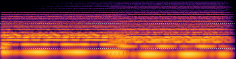 | [▶ listen (15 s)](media/bed-calm.mp3) |
| `pulse` | A minor, 96 BPM, 40.0 s loop | Tech and product explainers, step-by-step walkthroughs, data stories | 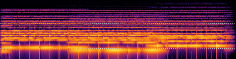 | [▶ listen (15 s)](media/bed-pulse.mp3) |
| `bright` | C major, 120 BPM, 48.0 s loop | Launches, tutorials, upbeat social clips, positive results | 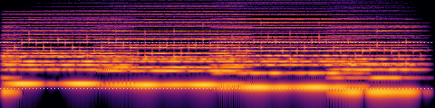 | [▶ listen (15 s)](media/bed-bright.mp3) |
| `cartoon` | G major, 128 BPM, 45.0 s loop | Cartoons and stories for children, comic or light-hearted scenes, playful how-tos | 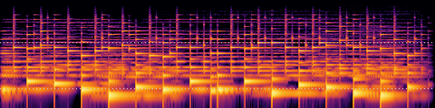 | [▶ listen (15 s)](media/bed-cartoon.mp3) |
| `lullaby` | F major, 64 BPM, 45.0 s loop | Bedtime stories, soft or sentimental moments, endings, calm scenes for young children | 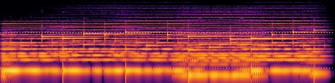 | [▶ listen (15 s)](media/bed-lullaby.mp3) |
| `discovery` | D minor, 104 BPM, 55.4 s loop | Documentaries approaching a discovery, science stories, explainers that build to a finding | 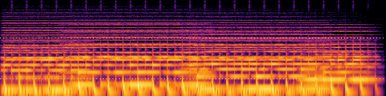 | [▶ listen (15 s)](media/bed-discovery.mp3) from 33.88 s: the pad at its brightest |
| `breakthrough` | C minor to E-flat major, 112 BPM, 51.4 s loop | A reveal or result that lands mid-video, problem-to-solution stories, before / after | 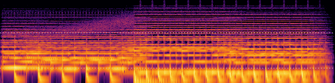 | [▶ listen (15 s)](media/bed-breakthrough.mp3) from 19.71 s: the lift to E-flat major |
| `enigma` | B minor, 96 BPM, 50.0 s loop | Mysteries and unsolved questions, investigations, history or true-crime style stories, space and the deep sea | 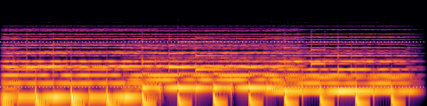 | [▶ listen (15 s)](media/bed-enigma.mp3) |
| `momentum` | G minor, 120 BPM, 48.0 s loop | Fast-paced explainers and Shorts, montages, countdowns, races and high-energy intros | 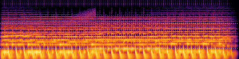 | [▶ listen (15 s)](media/bed-momentum.mp3) from 42 s: the riser into the top of the loop |
| `lab` | F minor, 108 BPM, 44.4 s loop | Technology, AI, software and engineering explainers, lab science, product demos with a modern feel | 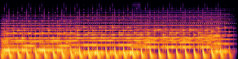 | [▶ listen (15 s)](media/bed-lab.mp3) |
| `ascent` | A minor, 136 BPM, 56.5 s loop | Energetic reveals, tech launches, montages, uplifting endings, a build to a climax | 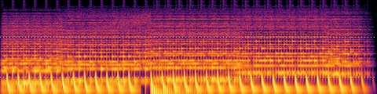 | [▶ listen (15 s)](media/bed-ascent.mp3) from 22.23 s: the build and the lift |
| `horizon` | D minor to F major, 132 BPM, 58.2 s loop | Energetic reveals, tech launches, montages, uplifting endings, anthemic intros | 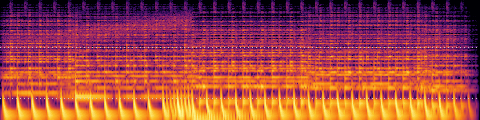 | [▶ listen (15 s)](media/bed-horizon.mp3) from 23.09 s: the build and the lift to F major |
| `beacon` | E minor, 120 BPM, 48.0 s loop | Space and astronomy, science, signals and data, steady explainers with a cosmic feel | 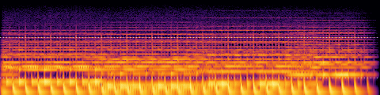 | [▶ listen (15 s)](media/bed-beacon.mp3) |
| `neon` | F-sharp minor, 116 BPM, 49.6 s loop | Tech at night, retro-futurism, cities, coding Shorts | 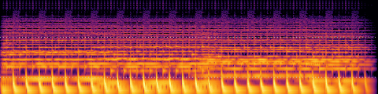 | [▶ listen (15 s)](media/bed-neon.mp3) |
| `tidewater` | E minor, 108 BPM, 53.3 s loop | Explainers and documentaries that need a steady, hopeful pulse: nature, the sea, travel, progress stories, calm walkthroughs | 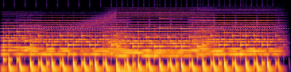 | [▶ listen (15 s)](media/bed-tidewater.mp3) from 20.66 s: the riser and the lift with its bell melody |
| `skyline` | D minor, 128 BPM, 60.0 s loop | Energetic reveals, product launches, montages, a build to a big moment, upbeat intros and endings | 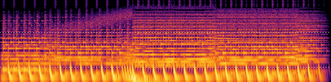 | [▶ listen (15 s)](media/bed-skyline.mp3) from 24 s: the end of the build and the lift |
| `time_of_flight` | B minor, 108 BPM, 53.3 s loop | Science and tech explainers, discovery and measurement stories, maps and navigation, how-things-work videos | 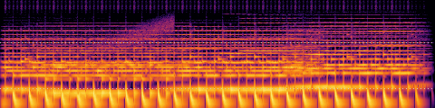 | [▶ listen (15 s)](media/bed-time_of_flight.mp3) from 20.66 s: the end of the build and the lift with its lead |

## Made with the score format

Music written as a score file: YAML with a key, a tempo, sections, chords and tracks of step
patterns, played by vidgen's own instruments. Agents write them without listening: they start
from a template of a built-in bed, change one thing at a time and read `vidgen music check`'s
report after each change. A score file in a project's `assets/music/` plays like a bed
(`music: my_theme`). How: [score files](../CONFIG.md#score-files-vidgen-music-render),
[templates of the beds](../CONFIG.md#templates-of-the-built-in-beds-vidgen-music-template),
[checking a piece](../CONFIG.md#checking-a-piece-vidgen-music-check),
[project pieces](../CONFIG.md#project-pieces-score-files-in-a-video) and the
[music craft notes](../COOKBOOK-MUSIC.md). The piece below was written this way and is now
a built-in bed (hear it in the beds table above).

| piece | key, tempo, length | how it was made | hear it |
|---|---|---|---|
| `time_of_flight` Time of Flight | B minor, 108 BPM, 53.3 s loop | An AI author's piece, made from the `momentum` template one change at a time (new key, tempo, chords, sections, arpeggio, pings and lead), checked with `vidgen music check` after each; approved as a built-in bed; it plays under [examples/gps-time-of-flight](../../examples/gps-time-of-flight/README.md), whose README keeps the log of every version and the check report | the bed `time_of_flight` above: [▶ listen (15 s)](media/bed-time_of_flight.mp3) |

To do the same by ear, [`vidgen studio`](../CONFIG.md#music-studio-vidgen-studio) opens any
bed above as an editable score in your web browser (it runs locally on your own computer,
offline): change it, listen as you go, A/B versions,
try variations, pin notes for an AI agent to answer, and save it into your project.

## Sound effects

36 sounds, synthesised when the video is joined: `- sfx: whoosh` in a beat, a scene's `sfx:` list, or
played by cartoon actions (foley: footsteps by surface, doors, pickups, rides). Each clip
plays several sounds at the times listed, 8 dB louder than in a mix; together they
play every built-in sound.

| clip | sounds (seconds into the clip) | spectrogram | listen |
|---|---|---|---|
| On-screen moments | 0.3 s `whoosh`, 1.3, 1.7, 2.1 s `pop` (pitch 0, +2, +4), 2.9 s `click`, 3.5, 3.9, 4.3 s `tick`, 5 s `typing`, 7 s `chime`, 8.8 s `success`, 10 s `error`, 11 s `swoosh`, 12.1 s `thud` | 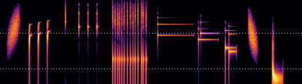 | [▶ listen (13.4 s)](media/sfx-screen.mp3) |
| A build and three stings | 0.3 s `riser`, 2.3 s `sting_reveal`, 4.6 s `sting_comic`, 6.5 s `sting_sad` | 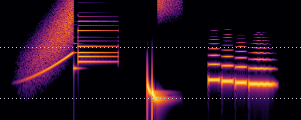 | [▶ listen (9.4 s)](media/sfx-stings.mp3) |
| Footsteps by surface: shoe, grass, gravel, wood, stone | 0.3, 0.75, 1.2, 1.65 s `footstep`, 2.6, 3.05, 3.5, 3.95 s `step_grass`, 4.9, 5.35, 5.8, 6.25 s `step_gravel`, 7.2, 7.65, 8.1, 8.55 s `step_wood`, 9.5, 9.95, 10.4, 10.85 s `step_stone` | 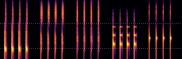 | [▶ listen (11.6 s)](media/sfx-footsteps.mp3) |
| Door, phone, bell | 0.3 s `knock`, 1.5 s `unlock`, 2.1 s `creak`, 3.6 s `phone`, 5.2 s `bell` | 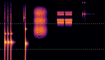 | [▶ listen (6.6 s)](media/sfx-home.mp3) |
| Cartoon foley and voice sounds | 0.3 s `boing`, 1.2, 1.6, 2 s `coin` (pitch 0, +2, +4), 2.7 s `twinkle`, 3.9 s `splash`, 5 s `beep`, 5.9 s `gasp`, 6.7 s `sigh` | 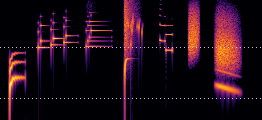 | [▶ listen (8.2 s)](media/sfx-cartoon.mp3) |
| Vehicles, a rocket and thunder | 0.3 s `engine`, 2 s `brakes`, 3 s `burner`, 4.6 s `launch`, 6.1 s `thunder` | 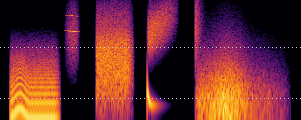 | [▶ listen (9.4 s)](media/sfx-rides.mp3) |

## Ambience beds

6 beds, played under cartoon scenes while the rain falls, a fire burns, or a set calls for them
(birds by day, crickets at night, a city street, a room's tone). The clip plays each for
3.5 s, in this order: `rain`, `fire`, `birdsong`, `city`, `room_tone`, `crickets`.

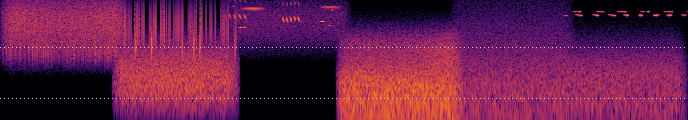

[▶ listen (21.5 s)](media/ambience.mp3)

## Composed music

With the `music` extra, `music: {compose: {mood: curious}}` writes original music for the
video and plays it with real instruments: every scene change on a bar line, a mood per
scene, swells on reveals and a closing cadence. Eight moods:

| mood | for | key, tempo |
|---|---|---|
| `calm` | calm explainers, reflective or serious topics, long narration | D major, 72 BPM, 4/4 |
| `focused` | tech and product explainers, step-by-step walkthroughs, data stories | A minor, 96 BPM, 4/4 |
| `curious` | science and how-it-works explainers, puzzles, discoveries | F major, 108 BPM, 4/4 |
| `upbeat` | launches, tutorials, upbeat social clips, positive results | G major, 116 BPM, 4/4 |
| `playful` | cartoons and children's stories, comic or light-hearted scenes | C major, 132 BPM, 4/4 |
| `sleepy` | bedtime stories, night scenes, soft or sentimental moments, endings | F major, 66 BPM, 3/4 |
| `tense` | suspense, a chase about to start, sneaking, a mystery, a problem before its solution | D minor, 104 BPM, 4/4 |
| `triumphant` | victories, solved problems, grand reveals, finales | Bb major, 112 BPM, 4/4 |

The first 15 s of a piece in two moods (default settings, `vidgen music preview --mood NAME`):

| mood | parts | spectrogram | clip |
|---|---|---|---|
| `curious` | melody: flute, chords: harp, bass: bass, drums: drums | 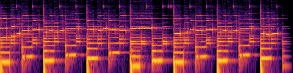 | [▶ listen (15 s)](media/composed-curious.mp3) |
| `playful` | melody: clarinet, chords: marimba, bass: tuba, drums: drums | 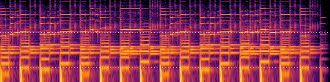 | [▶ listen (15 s)](media/composed-playful.mp3) |
